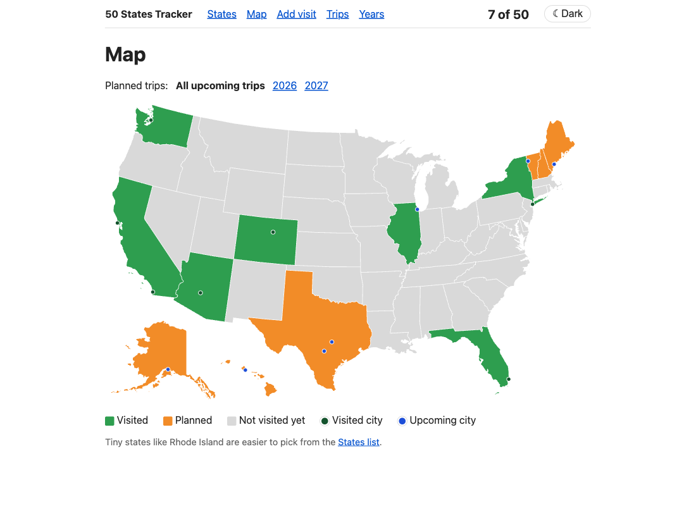
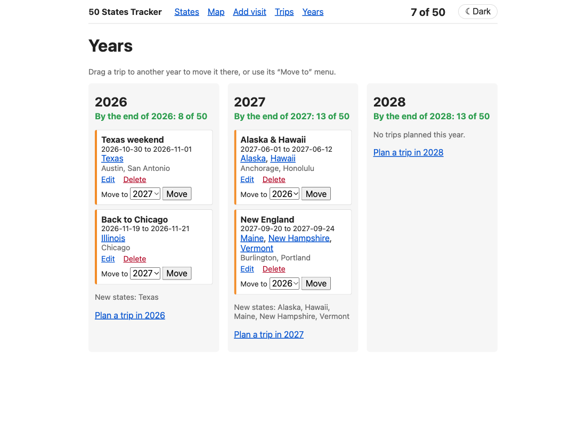
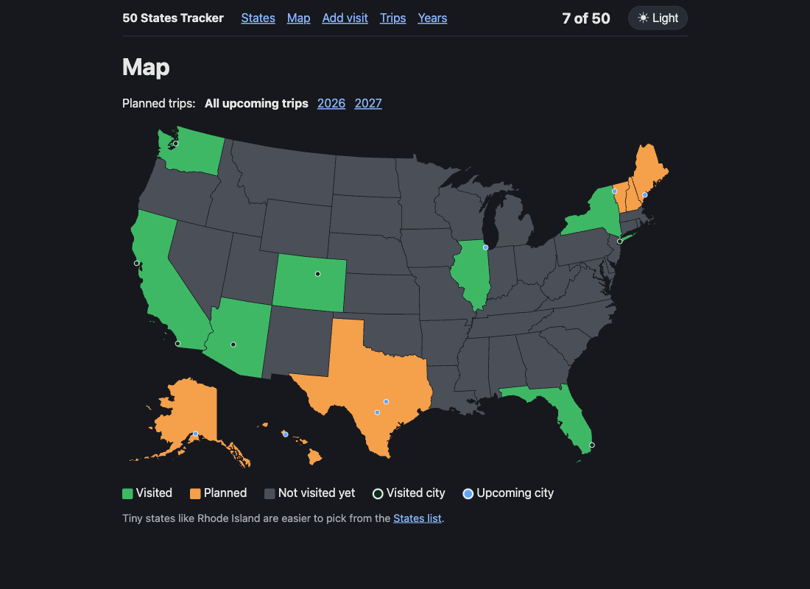
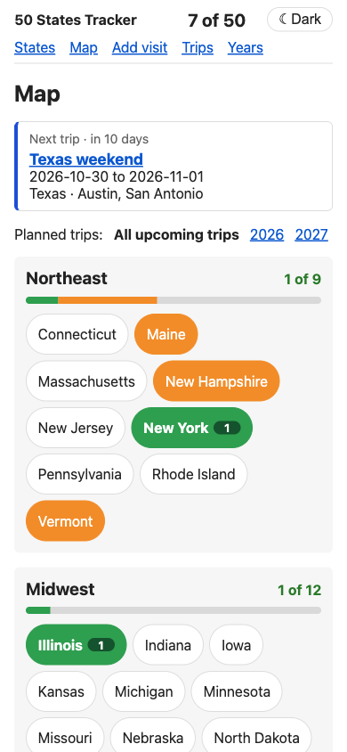
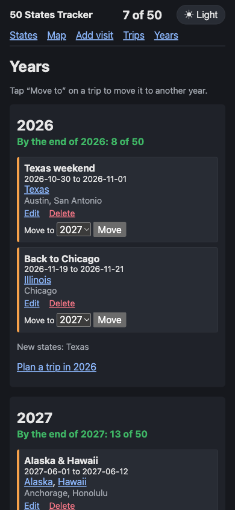
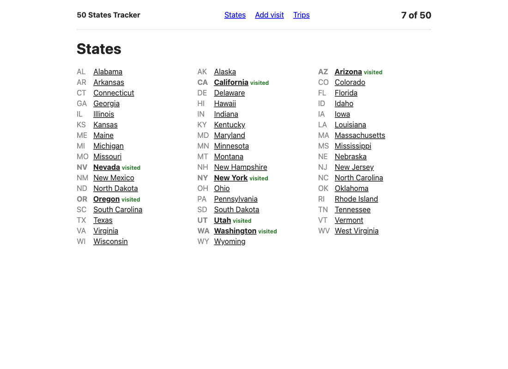
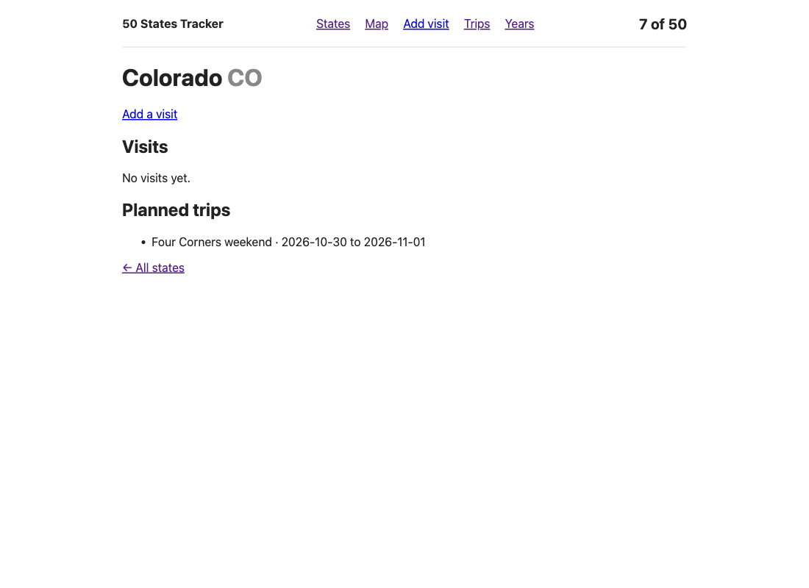
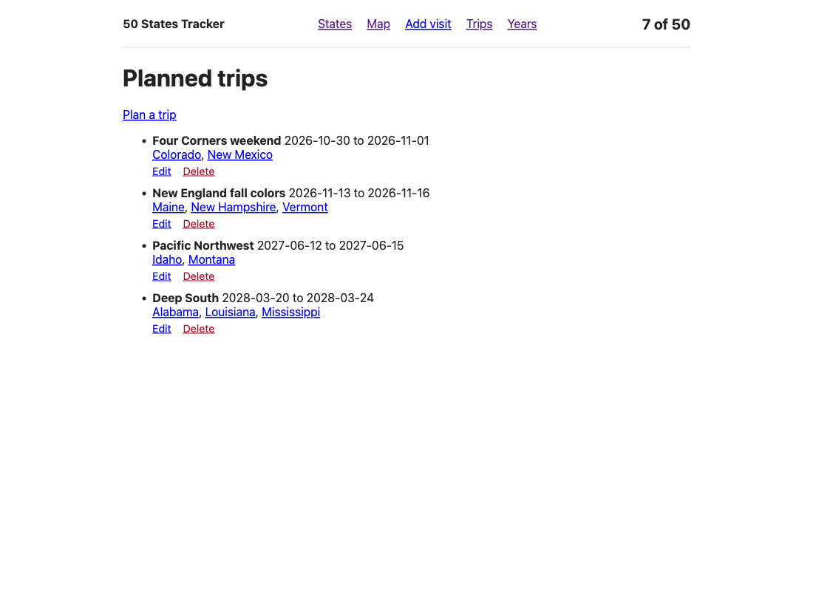
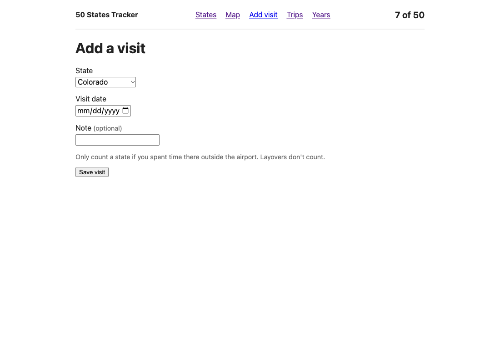
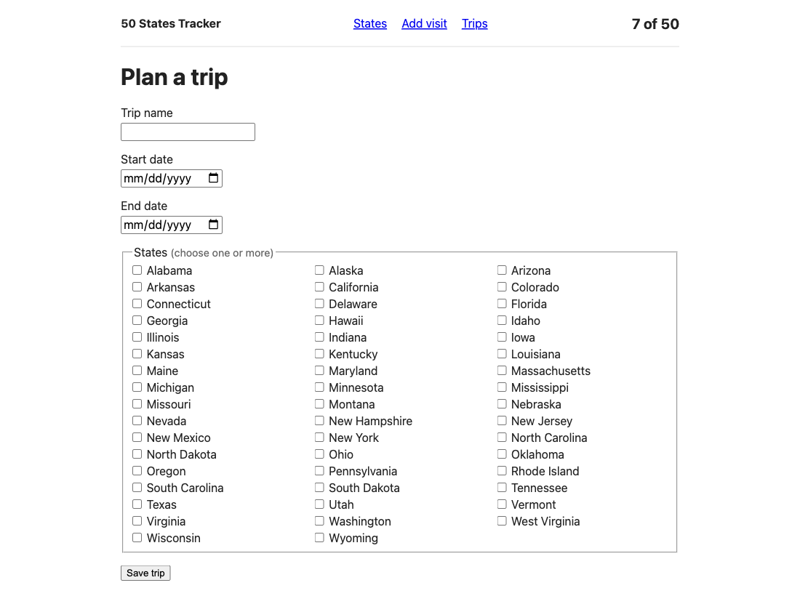

# 50 States Vacation Tracker

A small Flask web app to track trips through all 50 US states: which states
I've visited, when, and which weekend trips are planned next.

Private learning project, built with Python, Flask and SQLite.



*Screenshots show made-up example data.*

## Features

- **Clickable map:** every state links to its page. Green = visited,
  orange = in a trip that hasn't ended (including one happening now), grey = not yet. A year filter shows only one
  year's plans.
- **City dots:** every visited city gets a dark green dot, every city in a
  trip that hasn't ended a blue one (blue wins if it's both). Hover a dot to
  see its visit dates and trips; click it to open the state. On a phone or
  tablet, tap a dot once for its details and again to open the state.
- **Light and dark:** a button at the top switches the theme. With no choice
  saved, it follows your device.
- **Year planner:** one column per year with its trips, the new states it adds,
  and "By the end of 2027: 14 of 50". Drag a trip to another year to move it
  (or use its "Move to" menu). Plan, edit and delete trips right there.
- **States list:** all 50 states A to Z, with visited ones marked in bold.
- **Progress counter:** "7 of 50" in the header of every page.
- **Add visits:** state, date, an optional city (with suggestions from about
  32,000 US places) and an optional note. Visits can be edited and deleted
  from their state's page; the counter, map and region cards follow.
- **State pages:** each state's visits (newest first) and the planned trips that include it.
- **Planned trips:** a name, start and end date, one or more states, so nearby
  states can be combined into one weekend, and optional cities ("Denver, CO").
  Trips can be edited and deleted. Trips that have ended are hidden.
- **Phones and tablets:** every page fits an iPhone and an iPad. On a phone the
  year columns stack, and the "Move to" menu replaces dragging.
- **Region cards on phones:** a whole US map is too small to tap on a phone, so
  there `/map` shows your next trip and the four Census regions instead
  (Northeast, Midwest, South, West). Each region has a progress bar and its
  states as big tappable chips in the map's colors, with the number of cities
  you've visited there. Tablets and computers keep the map.

Every page reads the same database, so a change made on one page shows up on
all the others.



| Dark mode | Phone: region cards | Phone: years (dark) |
|---|---|---|
|  |  |  |

| States list | State page |
|---|---|
|  |  |

| Planned trips | Add a visit |
|---|---|
|  |  |

| Edit a trip |
|---|
|  |

## Rules the app follows

- There are exactly 50 states, with their official names and two-letter codes.
  Washington, D.C. is not included.
- A state can have several visits, but counts only once in the progress.
- A visit date can't be in the future (today is fine).
- A planned trip must start in the future (tomorrow at the earliest), and its
  end date can't be before its start date. A one-day trip is fine.
- A trip can include states that were already visited. Planning a trip doesn't
  count as visiting.
- A state counts as visited only after spending time there outside the
  airport. Layovers don't count. The app can't check this, so the visit form
  reminds you.
- Editing a trip may keep its current start date even if it has passed, so a
  trip in progress can still be renamed.
- A trip belongs to the year it starts in. Moving it to another year keeps its
  month, day and length (Feb 29 becomes Feb 28 in a year without one). A move
  that would put the trip in the past is refused.
- On the map, a state that's both visited and planned shows as visited.
- Cities are optional. A city must be in the city list and in its state, and
  a trip's cities must be in one of the trip's states. Cities never change the
  progress: one visit is enough to make a state green, and states count once.
- One dot per city, however many visits. A city that's visited and in a trip
  that hasn't ended shows the blue dot.

## Getting started

You need Python 3.

```bash
python3 -m venv .venv
source .venv/bin/activate
pip install -r requirements.txt
flask run
```

Then open http://127.0.0.1:5000. On a Mac, port 5000 is often taken by AirPlay
Receiver; use `flask run --port 5001` and open http://127.0.0.1:5001 instead.

The database is created automatically at `instance/tracker.sqlite` on the first
start. It's kept out of git. `flask init-db` sets it up by hand; running it
again keeps your data.

## On your iPhone's home screen

The app can live on your iPhone's home screen like an app: its own icon,
full screen, no Safari bars. It still runs on your Mac, so the Mac has to be
on with the app running, and the iPhone on the same Wi-Fi.

1. On the Mac, start the app so your Wi-Fi can reach it:

   ```bash
   flask run --host 0.0.0.0 --port 5001
   ```

   The first time, macOS may ask whether Python may accept incoming connections: choose Allow.
2. On the iPhone, open Safari and go to `http://<your-mac-name>.local:5001`
   (find the name with `scutil --get LocalHostName`).
3. Tap Share → **Add to Home Screen** → Add.

There's no login yet, so while the app runs with `--host 0.0.0.0`, anyone on
the same Wi-Fi could open it. Use it on your home Wi-Fi only. Plain `flask run`
(without `--host`) stays reachable from your Mac only.

## Running the tests

```bash
pytest
```

Each test uses its own temporary database, never the real one in `instance/`.

## Project structure

```
app.py                  # lets plain `flask run` find the app
tracker/
  __init__.py           # create_app(): builds the app and sets up the database
  db.py                 # database connection, init_db(), `flask init-db`
  schema.sql            # the tables
  states_data.py        # the 50 states
  map_data.py           # the 50 state outlines for the map
  map_shapes.py         # "is this point inside that state?" for the outlines
  cities.py             # the city list: find_city(), cities_in_state()
  regions_data.py       # the four Census regions, for the region cards
  data/us_cities.csv    # ~32,000 places with their spot on the map
  models.py             # reading and saving states, visits, trips and city dots
  validation.py         # the visit and trip rules
  routes.py             # the pages
  templates/            # HTML templates
  static/style.css      # layout, phone/tablet rules, light and dark colors
  static/years.js       # drag and drop on the year page
  static/theme.js       # the light/dark button
  static/cities.js      # city suggestions on the visit and trip forms
  static/map.js         # city dot details on touch screens
  static/manifest.webmanifest  # name, icon and full-screen mode for the home screen
  static/icons/         # app icons (home screen, browser tab)
scripts/build_cities.py # one-time builder for data/us_cities.csv (see below)
tests/                  # pytest tests, one file per feature
docs/screenshots/       # images for this README
```

## Database tables

| Table | Columns |
|---|---|
| `states` | `id`, `code` (e.g. CA), `name` (e.g. California) |
| `visits` | `id`, `state_id`, `visit_date`, `note`, `city` (optional) |
| `trips` | `id`, `name`, `start_date`, `end_date` |
| `trip_states` | `trip_id`, `state_id`. Links a trip to each of its states |
| `trip_cities` | `trip_id`, `state_id`, `city`. Links a trip to each of its cities |

Dates are stored as `YYYY-MM-DD` text. Cities are stored by name and state,
with the official spelling from the city list. A database made by an older
version of the app gets the new column and table when the app starts.

## Rebuilding the city list

`tracker/data/us_cities.csv` is already in the repo. To rebuild it, download
`2023_Gaz_place_national.zip` and `2023_Gaz_counties_national.zip` from the
[Census Gazetteer files](https://www.census.gov/geographies/reference-files/time-series/geo/gazetteer-files.html), then run:

```bash
python scripts/build_cities.py 2023_Gaz_place_national.zip 2023_Gaz_counties_national.zip
```

It lines the map projection up with the drawing, moves coastal towns just
inside their outline, and refuses to write the file unless all 50 state
capitals land inside their own state.

## Credits

The map outlines come from ["Blank US Map (states only).svg"](https://commons.wikimedia.org/wiki/File:Blank_US_Map_(states_only).svg)
by Heitordp on Wikimedia Commons, released under CC0 (public domain).

The city list is built from the US Census Bureau's
[Gazetteer files](https://www.census.gov/geographies/reference-files/time-series/geo/gazetteer-files.html)
(2023), a US government work in the public domain.

## Not yet

Trip costs, logins, and putting the app online.
